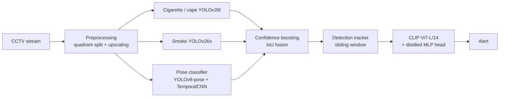

# A Hierarchical Multimodal Pipeline for Smoking Detection in CCTV Video with Cross-Domain Generalization

Official code and experiment notebooks for the paper

> **A hierarchical multimodal pipeline for smoking detection in CCTV video with cross-domain generalization**
> Mikhail Strezhnev (MIPT), Anton Surkov (HSE University)

The pipeline detects smoking (cigarettes, vapes and other nicotine-delivery devices) in real surveillance video. It combines two specialized YOLO detectors, IoU-based confidence boosting, a sliding-window tracker, a pose-based gesture classifier and a CLIP-based verifier with a distilled MLP head. Every learned component is trained **only on openly available data**. Real CCTV footage is used for two things only: calibrating five scalar fusion parameters on a small calibration slice, and evaluating on a disjoint held-out test slice.

<p align="center">
  
</p>
<p align="center"><em>Output of the full pipeline on a real CCTV frame from the test slice. Only the person holding a cigarette (ID 0) is flagged; the two bystanders are tracked with the same pose overlay and correctly left unflagged. Eyes are masked for privacy.</em></p>

## Key results

- **P = 0.947, R = 0.956, F1 = 0.951** (95% CI ±0.008) on held-out real CCTV recordings, measured out-of-domain.
- **+14.5 F1 points** (+18.0% relative) over a single-detector YOLO baseline (F1 = 0.806).
- A CLIP ViT-L/14 embedding distilled into a small MLP head beats the best zero-shot CLIP configuration by **14.3 F1 points** (0.951 vs 0.808).
- Size-stratified ("micro" / "small") training data: our cigarette/vape detector scores **35-40% higher mAP@0.5** than open-source community detectors on the same images.
- The full pipeline runs at **18.3 FPS** on a single NVIDIA A100.

## Pipeline



1. **Preprocessing.** Each frame is split into four non-overlapping quadrants, and each quadrant is upscaled to the detector input resolution. The detector therefore sees each object at roughly 4x its original size, which matters for cigarettes that occupy less than 0.2% of the frame.
2. **Two independent detectors.** YOLOv26l detects cigarettes and vapes. YOLOv26s detects smoke. The smoke detector never raises an alert by itself, which protects against fog, steam and industrial emissions.
3. **Confidence boosting.** Let $c$ be the confidence of a cigarette detection, and let $\mathrm{IoU}_p$ and $\mathrm{IoU}_s$ be its IoU with the nearest person box and the nearest smoke box. With $n = \mathbb{1}[\mathrm{IoU}_p \ge 0.3] + \mathbb{1}[\mathrm{IoU}_s \ge 0.1]$:

   $$
   c_1 = \begin{cases} 0.85\,c, & n = 0 \\ \min\big(c\,(1 + 0.25\,\mathrm{IoU}_p + 0.10\,\mathrm{IoU}_s),\ 0.85\big), & n \ge 1 \end{cases}
   $$

   If the pose classifier's smoking score exceeds $\theta_{\mathrm{hpe}} = 0.5$, then $c_{\mathrm{final}} = \min(c_1 (1 + 0.2\, s_{\mathrm{hpe}}), 1.0)$. The pose signal can raise confidence but never acts as a gate.
4. **Detection tracker.** An IoU-matching tracker assigns persistent IDs. An alert is raised once more than $T = 2$ of the last $N = 8$ frames contain a positive detection for a tracked object.
5. **CLIP verification.** A crop expanded 6x around the detection is embedded by a frozen CLIP ViT-L/14. An MLP head, `Linear(768->256) -> ReLU -> Dropout(0.3) -> Linear(256->1) -> Sigmoid`, makes the final decision. CLIP is called periodically for each tracked object, not on every frame.

## Results

All system-level numbers are measured **out-of-domain (OOD)**, on the held-out test slice of real CCTV recordings. No model was trained or fine-tuned on any of this footage.

### Contribution of each pipeline component

| Component                                    | Precision        | Recall           | F1               | 95% CI (F1)       |
| -------------------------------------------- | ---------------- | ---------------- | ---------------- | ----------------- |
| YOLO cigarette/vape (baseline)               | 0.7900           | 0.8220           | 0.8057           | ±0.012           |
| + smoke detection (confidence boost)         | 0.8450           | 0.8109           | 0.8276           | ±0.011           |
| + DetectionTracker                           | 0.8681           | 0.8394           | 0.8535           | ±0.013           |
| + HPE (TemporalCNN)                          | 0.8912           | 0.8531           | 0.8717           | ±0.018           |
| + CLIP ViT-L/14, detailed prompt (zero-shot) | 0.8103           | 0.8052           | 0.8077           | ±0.014           |
| **CLIP ViT-L/14 + MLP (final)**        | **0.9470** | **0.9560** | **0.9510** | **±0.008** |

Zero-shot CLIP used as a hard final gate rejects some genuine detections and lowers F1. Replacing it with the distilled MLP head removes this drawback.

### Cigarette / vape detector

Models are labelled by their training split. "Eval split" is the split used for the *test* columns.

| Model (train split)                 | Eval split | mAP@0.5 (test)  | P (test)        | R (test)        | F1 (test)       | P (OOD)         | R (OOD)         | F1 (OOD)        |
| ----------------------------------- | ---------- | --------------- | --------------- | --------------- | --------------- | --------------- | --------------- | --------------- |
| **YOLOv26l (small)**          | micro      | **0.830** | **0.845** | **0.811** | **0.828** | **0.828** | **0.794** | **0.811** |
| YOLOv26m (small)                    | small      | 0.685           | 0.789           | 0.749           | 0.769           | 0.773           | 0.732           | 0.752           |
| YOLOv26l (micro)                    | micro      | 0.676           | 0.810           | 0.714           | 0.759           | 0.792           | 0.698           | 0.742           |
| YOLOv26m (micro)                    | small      | 0.763           | 0.816           | 0.801           | 0.808           | 0.799           | 0.784           | 0.792           |
| Faster R-CNN                        | micro      | 0.731           | 0.731           | 0.695           | 0.712           | 0.715           | 0.680           | 0.697           |
| Enos123 YOLOv11m (open-source)      | micro      | 0.391           | 0.651           | 0.455           | 0.536           | 0.637           | 0.446           | 0.525           |
| AarnoStormborn YOLOv5 (open-source) | micro      | 0.309           | 0.660           | 0.386           | 0.487           | 0.646           | 0.378           | 0.477           |

### Smoke detector

| Model              | Type        | Eval split | mAP@0.5 (test)  | P (test)        | R (test)        | F1 (test)       | P (OOD)         | R (OOD)         | F1 (OOD)        |
| ------------------ | ----------- | ---------- | --------------- | --------------- | --------------- | --------------- | --------------- | --------------- | --------------- |
| **YOLOv26s** | in-house    | micro      | **0.733** | **0.740** | **0.724** | **0.732** | **0.721** | **0.706** | **0.714** |
| YOLOv26m           | in-house    | micro      | 0.599           | 0.592           | 0.630           | 0.610           | 0.577           | 0.615           | 0.595           |
| YOLOv26s           | in-house    | small      | 0.718           | 0.729           | 0.645           | 0.684           | 0.712           | 0.630           | 0.669           |
| YOLOv26m           | in-house    | small      | 0.729           | 0.738           | 0.644           | 0.688           | 0.721           | 0.630           | 0.672           |
| TommyNgx YOLOv10   | open-source | micro      | 0.643           | 0.762           | 0.632           | 0.691           | 0.744           | 0.617           | 0.674           |
| leeyunjai YOLOv11s | open-source | micro      | 0.119           | 0.623           | 0.157           | 0.251           | 0.608           | 0.154           | 0.245           |
| leeyunjai YOLOv11x | open-source | micro      | 0.116           | 0.553           | 0.162           | 0.250           | 0.540           | 0.158           | 0.244           |

### Pose-based gesture classifiers (smoking class)

| Model                              | F1 (test)       | ROC-AUC (test)  | PR-AUC (test)   | F1 (OOD)        | ROC-AUC (OOD)   | PR-AUC (OOD)    |
| ---------------------------------- | --------------- | --------------- | --------------- | --------------- | --------------- | --------------- |
| RandomForest                       | 0.567           | 0.974           | 0.662           | 0.548           | 0.961           | 0.649           |
| GradientBoosting + SMOTE           | 0.611           | 0.981           | 0.561           | 0.591           | 0.967           | 0.548           |
| SVM-RBF                            | 0.521           | 0.723           | 0.614           | 0.502           | 0.709           | 0.602           |
| MLP (1 hidden layer)               | 0.602           | 0.978           | 0.683           | 0.581           | 0.964           | 0.669           |
| GBM + SMOTE (periodicity features) | 0.636           | 0.970           | 0.722           | 0.615           | 0.956           | 0.708           |
| ST-GCN                             | 0.727           | 0.970           | 0.729           | 0.709           | 0.956           | 0.715           |
| **TemporalCNN**              | **0.800** | **0.988** | **0.833** | **0.781** | **0.975** | **0.820** |

A Pose-Transformer was also tried, but it did not converge at the available data volume.

### CLIP verification

Zero-shot verification, evaluated on real CCTV footage:

| Configuration                             | Threshold      | P (OOD)         | R (OOD)         | F1 (OOD)        |
| ----------------------------------------- | -------------- | --------------- | --------------- | --------------- |
| CLIP RN50 / basic prompt                  | 0.40           | 0.827           | 0.661           | 0.735           |
| CLIP RN50 / detailed prompt               | 0.35           | 0.828           | 0.722           | 0.771           |
| CLIP ViT-L/14 / basic prompt              | 0.30           | 0.838           | 0.543           | 0.659           |
| **CLIP ViT-L/14 / detailed prompt** | **0.35** | **0.810** | **0.805** | **0.808** |
| Tuned YOLO (no VLM)                       | -              | 0.759           | 0.852           | 0.803           |
| Baseline YOLO (no VLM)                    | -              | 0.790           | 0.822           | 0.806           |

Embedding distillation (complete pipeline, real CCTV footage):

| Configuration                 | P (OOD)         | R (OOD)         | F1 (OOD)        |
| ----------------------------- | --------------- | --------------- | --------------- |
| LogReg baseline (CLIP RN50)   | 0.878           | 0.918           | 0.897           |
| MLP (CLIP RN50)               | 0.910           | 0.926           | 0.918           |
| LogReg (CLIP ViT-L/14)        | 0.945           | 0.922           | 0.933           |
| **MLP (CLIP ViT-L/14)** | **0.947** | **0.956** | **0.951** |

### Comparison with published systems

| System                            | P               | R               | F1              | Out-of-domain evaluation |
| --------------------------------- | --------------- | --------------- | --------------- | ------------------------ |
| Wang et al. (2023), YOLOv8-MNC    | 0.920           | 0.790           | 0.850           | No                       |
| Lakatos et al. (2024), multimodal | 0.980           | -               | -               | No (text modality)       |
| **This work**               | **0.947** | **0.956** | **0.951** | **Yes**            |

### Runtime

Measured over 5 runs of 500 frames each. Full pipeline: 2x YOLO + DetectionTracker + HPE + CLIP.

| Hardware                   | FPS  | 2x YOLO (ms/frame) | HPE (ms/frame) | CLIP (ms) | Tracker (ms) |
| -------------------------- | ---- | ------------------ | -------------- | --------- | ------------ |
| NVIDIA A100 40GB           | 18.3 | 24.1               | 8.3            | 51.2      | 2.1          |
| NVIDIA V100 32GB           | 9.7  | 42.8               | 15.1           | 98.6      | 2.4          |
| Intel Core i7-12650H (CPU) | 4.8  | 87.3               | 31.5           | 189.4     | 3.2          |

## Repository structure

```
.
├── notebooks/
│   ├── 01_data_preparation.ipynb              # aggregation of 16 sources, micro/small size-stratified splits
│   ├── 02_cigarette_detector_training.ipynb   # Faster R-CNN and YOLOv26l training and evaluation
│   ├── 03_cigarette_detector_comparison.ipynb # own detectors vs open-source cigarette detectors
│   ├── 04_smoke_detector_comparison.ipynb     # own YOLOv26 smoke detectors vs open-source fire/smoke models
│   ├── 05_pose_estimation.ipynb               # YOLOv8-pose features, gesture classifiers, tracking and fusion
│   └── 06_clip_verification.ipynb             # zero-shot CLIP verification and MLP distillation
├── assets/
│   └── qualitative_example.png
├── requirements.txt
└── README.md
```

| Notebook                             | Paper section                         | Tables              |
| ------------------------------------ | ------------------------------------- | ------------------- |
| `01_data_preparation`              | 3.2 Datasets                          | -                   |
| `02_cigarette_detector_training`   | 3.3, 4.2 Cigarette and vape detection | Table 2             |
| `03_cigarette_detector_comparison` | 4.2 Cigarette and vape detection      | Table 2             |
| `04_smoke_detector_comparison`     | 4.3 Smoke detection                   | Table 3             |
| `05_pose_estimation`               | 3.3 Human pose estimation, 4.4        | Table 4, Appendix A |
| `06_clip_verification`             | 3.3 CLIP verification, 4.5-4.6        | Tables 5-6          |

## Data

Training uses public data only:

- **Cigarette / vape detection.** About 70,000 labelled images from 16 Roboflow Universe and Kaggle datasets, harmonized into a single `smoking` class. Each source keeps its original train/val/test split. Two size-stratified subsets are built:
  - *micro*: bounding box at most 0.2% of the image area (8,544 / 1,240 / 920 images);
  - *small*: bounding box at most 1.0% of the image area (27,286 / 3,933 / 2,738 images).
- **Smoke detection.** D-Fire, a Roboflow fire-smoke dataset, the METU fire/smoke dataset and Smoke100K. Only the smoke labels are kept. The micro/small thresholds are 0.5% and 4% of the frame area.
- **Pose classification.** HMDB51, MEVA and in-house annotation: 555 training videos (88 smoking) and 137 validation videos (21 smoking), a class ratio of about 1:14.
- **CLIP head.** 5,000 balanced crops (3,000 / 1,000 / 1,000) taken from the training portion of the cigarette/vape data.

The real-world CCTV recordings used for calibration and out-of-domain evaluation (203 clips: 163 with smoking, 40 without) were provided by a third party under a data-use agreement. They are not publicly redistributable.

## Setup

```bash
git clone https://github.com/tired-racoon/HSE_smoking_detection.git
cd HSE_smoking_detection
python -m venv venv && source venv/bin/activate
pip install -r requirements.txt
```

The experiments were run with Python 3.10, PyTorch 2.6 and Ultralytics 8.4.12 on NVIDIA GPUs. Each notebook expects the datasets in the YOLO directory layout under the paths set in its configuration cell. For example, the micro cigarette data goes in `yolo_dataset/{train,val,test}/{images,labels}` and the micro smoke data goes in `smoke_yolo_dataset_micro/`. Notebook `03` downloads Roboflow weights and needs a Roboflow API key:

```bash
export ROBOFLOW_API_KEY=<your key>
```

Training setup used for the detectors: AdamW, cosine annealing ($T_{\max} = 100$), 100 epochs, batch size 16, seed 42, and 5 independent runs for 95% confidence intervals.

## Citation

If you use this code, please cite:

```bibtex
@article{strezhnev2026smoking,
  title   = {A hierarchical multimodal pipeline for smoking detection in CCTV video with cross-domain generalization},
  author  = {Strezhnev, Mikhail and Surkov, Anton},
  journal = {Expert Systems With Applications},
  year    = {2026},
  note    = {Submitted}
}
```

## Contact

Mikhail Strezhnev: strezhnev.ma@phystech.edu
